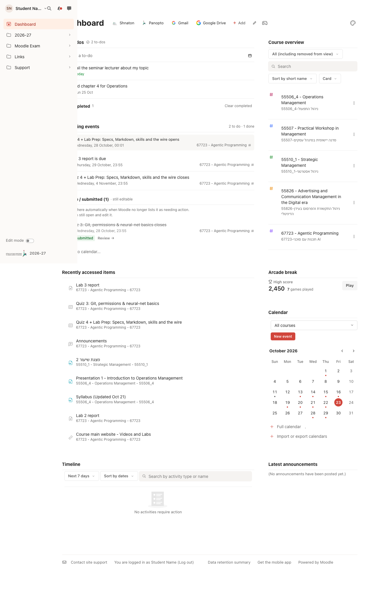
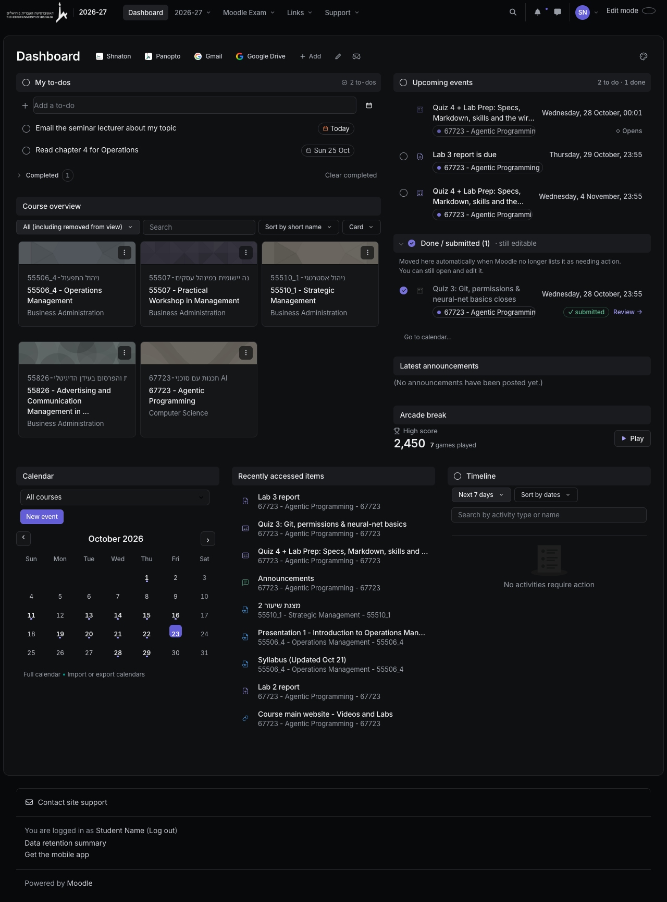
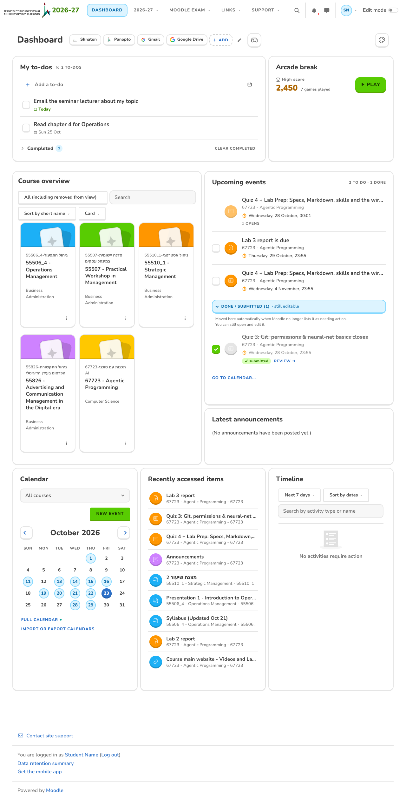
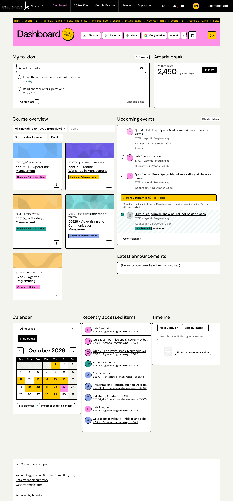

# Re-Moodle

Remodel the Moodle. A Chrome extension that makes HUJI's Moodle (`moodle.huji.ac.il`, every year site) nicer and more helpful:

- **10 themes + Moodle default.** Each theme follows one design reference: **Quiet Focus** (Todoist), **Night Operator** (Linear dark), **Daily Quest** (Duolingo), **Campus Pop** (Gumroad neo-brutalist, the crazy one), **Ahead**, **Fal** (fal.ai), **Giga Dusk** (giga.ai), **Cloudstudio**, **Butter** (butter.us) and **Clay** (clay.com). Switch from the palette button next to "Dashboard" or from the toolbar popup. Every theme also restyles HUJI's login page (CSS only) and the scrollbars.
- **Upcoming events, split.** Things you already submitted or finished move into a collapsible **Done / submitted, still editable** section, auto-ticked, with an "Edit submission" / "Review" link. You can also tick or untick by hand.
- **My to-dos.** A personal to-do block with due dates, a Completed section, drag to reorder, and sync across your Chrome profiles.
- **Shortcuts.** Link chips on the same line as "Dashboard". Paste a URL and the name fills itself in; hover a chip for a preview card.
- **Confetti.** Fires every time you submit an assignment, finish a quiz or post in a forum, in each theme's own style.
- **Deadline Dash.** A tiny arcade game (gamepad button). Click the falling assignments before the deadline line. Your high score is always saved.

| Quiet Focus | Night Operator |
|---|---|
|  |  |
| **Daily Quest** | **Campus Pop** |
|  |  |

## Install (unpacked)

1. Open `chrome://extensions` and turn on **Developer mode** (top right).
2. Click **Load unpacked** and pick this folder (the one with `manifest.json`).
3. Open your Moodle dashboard and click the palette button to pick a theme.

After pulling changes, click the reload ↻ icon on the extension card.

## How "done" is decided (dynamic and deterministic)

On every dashboard load, every time Moodle re-renders the block, and every time you come back to the tab, the extension asks Moodle two things: the upcoming events, and the events that **still need action**. Then one pure function, `classify` in `src/classify.js`, decides each event:

1. Your manual tick or untick wins.
2. "Opens" events, and anything that isn't an action, are info, so they get no checkbox.
3. An event still in Moodle's needs-action list is **to do**.
4. Otherwise it's **done**, because Moodle drops finished items from that list.

Nothing is hard-coded to a student, course or year. If Moodle's API fails, the block is left exactly as Moodle drew it.

## Development

No build step: vanilla JS and CSS, Manifest V3.

```bash
npm install          # Playwright, for the tests only
npm test             # classify unit table
npm run e2e          # every feature, in real Chromium with the extension loaded
npm run shots        # regenerate docs/screenshots/
npm run vendor       # one-time: mirror HUJI's theme CSS/images into fixtures/vendor (needs network)
```

`tests/harness.mjs` loads the unpacked extension in Chromium and serves `fixtures/` at the real Moodle URLs, so the real manifest applies. It never touches the real site:
- `launch({live: true})` serves `fixtures/live/*.html`. These are sanitized copies of real pages (dashboard, a course, the calendar, an assignment, a quiz, the IdP login), exported once with `tests/capture-moodle.js` and split with `tests/split-fixtures.mjs`.
- HUJI's real CSS comes from the gitignored mirror in `fixtures/vendor/`.
- `fixtures/service-mock.json` holds the live API response shapes.

Layout:
- `src/core.js`: shared `NM` helpers and the drawn icon set.
- `src/features/*`: one file per feature.
- `themes/*.css`: each scoped to `html[data-nm-theme=…]` and built on the `--nm-*` tokens in `src/base.css`.
- `src/login.css`: the shared login layout.
- `tools/giga/`: `giga.css` is generated from the template there.
- `research/`: the briefs and Mobbin references.

## What was verified where

- **Against the real HUJI Moodle (2026-10-23):** the dashboard DOM, the `osiris` theme classes, and the two calendar web services and their response shapes. The done signal was checked on a real account: a finished quiz is absent from the needs-action list, while unsubmitted work is present. Also confirmed that `core_course_get_course_module` and `mod_*` services are disabled there.
- **Against sanitized copies of real pages, offline, in real Chromium with HUJI's real CSS:** everything the extension renders, all 10 themes at 1440px and 390px on the dashboard, course, calendar, assignment, quiz and login pages, the confetti submit flows, the game, and storage sync between tabs.

  Moodle's own JS doesn't run in the copies, so open dropdowns, the phone "More" menu and the live submit pages still deserve a look on the real site.

Known limits:
- The shortcuts preview needs the `<all_urls>` host permission to read other sites' titles.
- To-dos live in `chrome.storage.sync`, which allows about 8 KB per key (roughly 80 to-dos).
